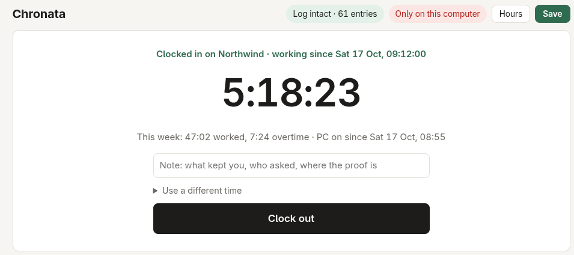
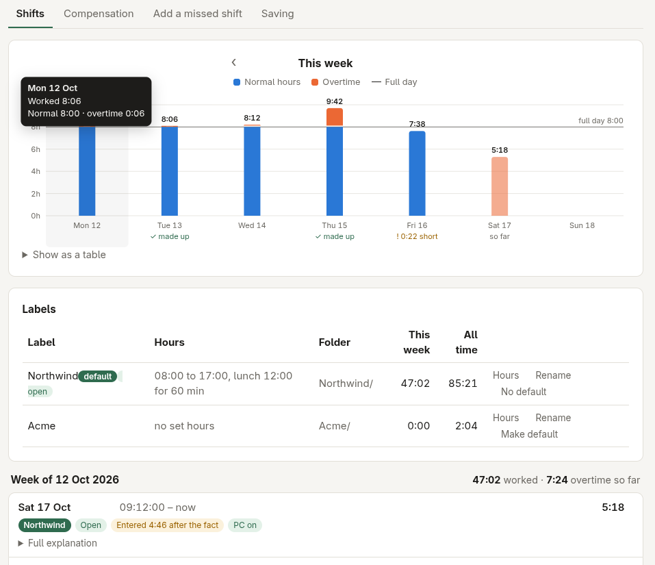

# Chronata

A record of the time you work that anyone can check, kept wherever you choose.

A timesheet is only worth something if the person reading it can trust it was written when it says. So every entry is sealed to the one before it, and an edit, deletion or backdated entry shows up. After each save, outside timestamp authorities (DigiCert and FreeTSA) sign a receipt for the latest entry, so the times don't rest on your own computer's clock.

Because the proof travels with the log, it can be saved anywhere: an Obsidian vault, a plain folder, a git host or a WebDAV server. Each copy checks out on its own with `chronata verify --folder <copy>`.

Mistakes are corrected or marked as mistakes, never deleted, because a visible correction is more credible than a clean record.

The PC's on and off times are sealed alongside your shifts as corroboration. A PC being on is not work, so it never counts by itself. But a click on a clock-in button proves no more than the PC coming on, so when you were working from the moment the PC came on, the day can start there, proven by the timestamp the PC-on record was sealed with seconds after boot rather than by when you remembered to click.

Overtime is owed by whoever it was worked for. So each client or project keeps its own hours, its overtime is measured against them alone, and what it pays or gives as time off is matched to that overtime and nobody else's. A late start is made up as soon as the time due by then has been worked, and only after that does overtime begin.





## Install

Chronata needs Python 3.10 or newer, with nothing extra from pip, and the programs under [Needs](#needs). `install.sh` links the `chronata` command, adds Chronata to the applications menu and starts it in the background at every login, for the page, the PC on and off records and the reminders. It never asks for sudo.

### Omarchy

Add the plugin for the clock on the bar, then run its `install.sh` once for the background part, which Omarchy plugins cannot start themselves:

```sh
omarchy plugin add https://github.com/Libertas-le-Spes/chronata.git --enable --yes
omarchy bar move kayu.chronata --section right
~/.config/omarchy/plugins/kayu.chronata/install.sh
chronata setup
```

Click the clock to clock in or out; right-click it for the full log.

To update, then restart the bar and the background part, which only load new code when they start:

```sh
omarchy plugin update kayu.chronata --yes
omarchy-restart-shell
systemctl --user restart chronata
```

To remove it:

```sh
~/.config/omarchy/plugins/kayu.chronata/install.sh --remove
omarchy plugin remove kayu.chronata --yes
```

### Any other Linux desktop

```sh
git clone https://github.com/Libertas-le-Spes/chronata.git ~/.local/share/libertas-le-spes/chronata
~/.local/share/libertas-le-spes/chronata/install.sh
chronata setup
```

`install.sh --remove` undoes it.

Removing Chronata never deletes your log or settings; they stay in `~/.local/share/chronata` and `~/.config/chronata`.

## Who can open the page

The log holds your hours and where it is saved, so the page opens only for you, even on a computer other people log into. Open it from the bar, the applications menu or `chronata ui`: each of these opens a one-time link, and the page then stays open in that browser for up to twelve hours or until Chronata restarts. A bookmarked or typed address shows a notice instead.

Each request must come from your own user account, carry that browser's visit, and come from the page itself. The one-time links are handed out only to programs that can read a key kept where only you can open it (`$XDG_RUNTIME_DIR/chronata`), and Chronata will not start the page if that folder is open to anyone else.

## Needs

Python 3.10 or newer. Chronata also uses these programs where they exist. Omarchy comes with all of them except `zenity`, which it can do without:

| Program | For | Without it |
|---|---|---|
| `journalctl`, or `last` on systems without systemd | the PC's on and off times | no PC records |
| `systemctl` | running in the background and noticing a shutdown | `install.sh` starts Chronata from the desktop's autostart instead |
| `notify-send` | reminder pop-ups | no pop-ups |
| `zenity` or `kdialog` | questions when clocking in from a bar | the page opens instead |
| `git` | saving the log to a git repository | the other kinds of place still work |
| `secret-tool`, with a desktop keyring such as GNOME Keyring or KWallet | keeping a web server's password | web server places can't be added; the password is never kept in a plain file |
| `openssl` | checking every timestamp receipt's signature, against that service's own root certificate, before it is kept or shown | no receipt is kept or vouched for, and `chronata verify` says it cannot check |

It also needs a web browser for its page, and internet access to reach the DigiCert and FreeTSA timestamp services.
